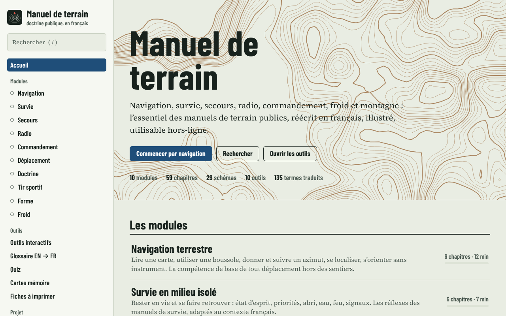
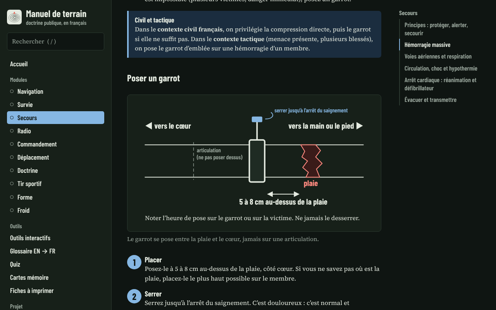
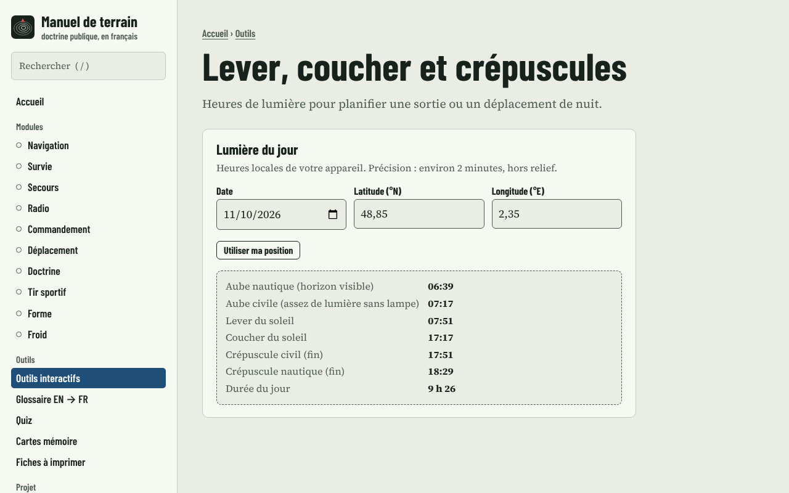
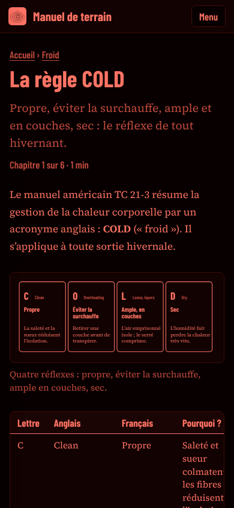

# Manuel de terrain

**Navigation, survie, secours, radio, commandement, froid et montagne** : l’essentiel des manuels de terrain
publics des forces armées américaines, **réécrit en français**, illustré de schémas, avec quiz, cartes mémoire,
glossaire anglais → français et outils de calcul. Une application web statique, **sans dépendance, sans serveur,
utilisable hors-ligne** (PWA).

> Inspiré par la bibliothèque « Field Manual Vault » de T.REX ARMS (4 215 manuels du domaine public, 724 471 pages).
> Ce projet est **indépendant** : il n’est affilié ni à T.REX ARMS ni à aucune armée.

## Aperçu

| Accueil (thème jour) | Schéma de chapitre (thème nuit) |
|---|---|
|  |  |

| Outil Lever et coucher du soleil | Mobile, thème « lampe rouge » |
|---|---|
|  |  |

## Contenu

| Module | Ce que l’on y apprend |
|---|---|
| **Navigation terrestre** | Cartes, courbes de niveau, coordonnées, boussole, azimuts, les trois nords, se localiser, s’orienter sans instrument |
| **Survie en milieu isolé** | Priorités (règle des trois), abri, eau, feu, signaux, chaleur |
| **Secours et soins tactiques** | Logique MARCH, hémorragie et garrot, voies aériennes, PLS, choc, arrêt cardiaque, évacuation |
| **Transmissions** | PMR446, CB, radio amateur, portée, procédure, alphabet phonétique, plan PACE |
| **Commandement et planification** | Boucle OODA, METT-TC, conduite d’une mission, ordre en cinq paragraphes, retour d’expérience |
| **Déplacement et discrétion** | Formations, haltes, nuit, observation de la faune, franchissements |
| **Doctrine et pensée stratégique** | Clausewitz, attrition contre manœuvre, principes de la guerre, droit des conflits armés |
| **Tir sportif** | Sécurité, position, visée, détente, lecture des groupements (tir de cible en stand agréé) |
| **Condition physique** | Cinq piliers, entraînement, poids du corps, marche chargée, nutrition, sommeil, mental |
| **Froid, neige et montagne** | COLD, trois couches, hypothermie, gelures, avalanche (sensibilisation), altitude, orages |

En chiffres : **10 modules, 59 chapitres, 29 schémas SVG, 71 questions de quiz, 135 termes de glossaire,
11 outils interactifs, 6 parcours conseillés, 19 sources.**

### Fonctions

- **Schémas SVG** dessinés par le code, qui suivent le thème (jour, nuit, **lampe rouge** pour préserver la vision nocturne).
- **Quiz** par module et quiz général, avec explications et meilleurs scores ; **cartes mémoire** retournables (glossaire anglais → français, par module).
- **Recherche plein texte** insensible aux accents (raccourci `/`).
- **Outils** : azimuts et nords, estime du pas et règle de Naismith, échelle et pente, lever/coucher du soleil,
  alphabet phonétique, DTG, ordre en cinq paragraphes, message d’alerte, chronomètre de pose de garrot, check-lists.
- **Plateau tactique** : plan sur grille (murs, portes), pions bleus, rouges et neutres, flèches, étapes animées,
  champs de vision arrêtés par les murs, export et import. Pour l’airsoft, le paintball, les jeux et les exercices.
- **Fiches imprimables** (feuilles de style d’impression).
- **Hors-ligne** : service worker avec pré-cache complet, installable sur téléphone.
- **Accessible** : navigation au clavier, lien d’évitement, contrastes, `prefers-reduced-motion`.
- **Confidentialité** : aucun suivi, aucune requête vers un tiers ; la progression reste dans `localStorage`.

## Périmètre et limites (à lire)

- Le projet vise l’**autonomie, le secours, l’orientation, l’organisation et la culture générale**.
  Il **exclut volontairement** les explosifs et démolitions, les armes improvisées, les agents NRBC, les pièges,
  le tir sur personne et les techniques d’attaque ou d’embuscade.
- Ce ne sont **pas des traductions mot à mot** : ce sont des **synthèses et réécritures originales**, adaptées
  au contexte français (numéros d’urgence 112, 15, 18, 3114 ; BERA ; réglementation des armes et de la radio).
  Les sources d’origine sont listées dans `data/sources.js` : **vérifiez toujours** les points critiques
  (techniques de secours, réglementation) auprès des documents d’origine et d’un professionnel.
- Les rédactions s’appuient sur la structure et les principes des manuels cités, sans avoir été relues mot à mot
  contre chacun d’eux. Les adresses des fiches ont été relevées sur la page de la bibliothèque et n’ont pas toutes
  été ouvertes une à une : signalez tout lien mort ou toute imprécision par une *issue*.
- L’application **ne remplace pas une formation** : secourisme (PSC1), montagne et neige, tir sportif, radio.
- Le droit (armes, radio, accès aux espaces naturels, feux) évolue : renseignez-vous auprès des autorités.

## Démarrer

Aucune installation n’est nécessaire pour lire le site :

```bash
git clone <url-de-votre-dépôt> manuel-de-terrain
cd manuel-de-terrain
python3 -m http.server 8080        # puis http://localhost:8080
```

Ouvrir `index.html` directement dans un navigateur fonctionne aussi (le mode hors-ligne exige http/https).

### Vérifications

```bash
npm run build   # construit _site/ : un seul script et une seule feuille de style (ce que publie GitHub Pages)
npm test        # valide le contenu (modules, schémas, quiz, liens, glossaire, sources, pré-cache) et la syntaxe JS
```

Node 18 ou plus récent suffit ; il n’y a aucune dépendance à installer.

## Publier sur GitHub Pages

1. Créez un dépôt **vide** sur GitHub (par exemple `manuel-de-terrain`).
2. Depuis ce dossier :
   ```bash
   git remote add origin https://github.com/<votre-compte>/manuel-de-terrain.git
   git push -u origin main
   ```
3. Dans **Settings → Pages**, choisissez **Source : GitHub Actions**.
4. Le workflow `Publication sur GitHub Pages` valide le contenu, puis publie le site
   (`https://<votre-compte>.github.io/manuel-de-terrain/`). Il met aussi à jour le numéro de version du cache hors-ligne.

## Structure

```
index.html            coquille de l’application
css/                  style.css (mise en page, thèmes, impression), diagrams.css (schémas)
js/core.js            registre MT, constructeurs de blocs, boîte à outils SVG
js/diagrams-*.js      les 29 schémas
js/tools.js           les 11 outils interactifs
js/app.js             routeur, vues, recherche, quiz, cartes mémoire
data/                 contenu : un fichier par module, glossaire, sources, parcours
scripts/              validation du contenu et de la syntaxe
sw.js, manifest…      PWA : hors-ligne et installation
docs/ARCHITECTURE.md  comment ajouter un module, un schéma ou un outil
```

## Contribuer

Corrections, nouveaux chapitres, relectures par des professionnels (secouristes, guides, moniteurs) :
voir [CONTRIBUTING.md](CONTRIBUTING.md) et [docs/ARCHITECTURE.md](docs/ARCHITECTURE.md).

## Licences

- **Code** : MIT (`LICENSE`).
- **Contenu rédactionnel** : CC BY 4.0 (`LICENSE-CONTENU.md`).
- **Polices** : SIL OFL 1.1 (`assets/fonts/`).
